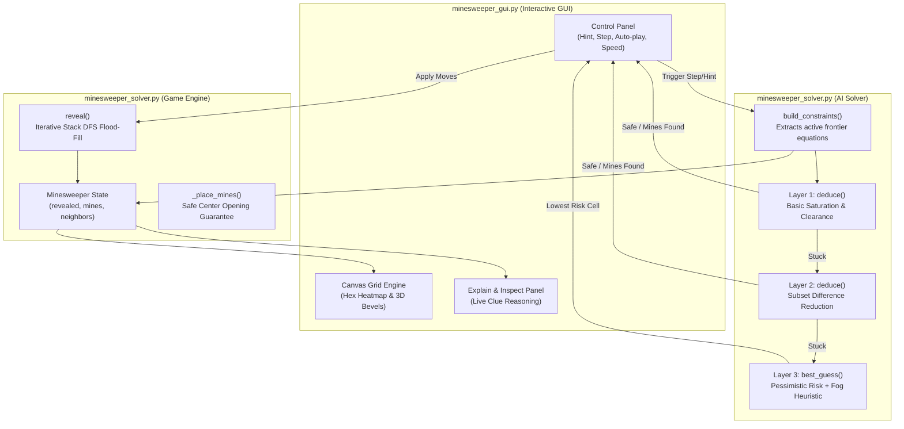

# Minesweeper AI Solver & Interactive Visualizer

[](https://www.python.org/)
[](https://docs.python.org/3/library/tkinter.html)
[](#algorithmic-architecture)
[-brightgreen.svg)](#requirements--installation)
[](#)

An intelligent Minesweeper engine, multi-tier constraint-satisfaction AI solver, and real-time interactive desktop visualizer built purely using the Python standard library.

The AI utilizes a three-tier decision hierarchy: **single-clue clearance/saturation**, **pairwise subset difference reduction**, and **probabilistic risk estimation with information-seeking fog-of-war heuristics** when logic is exhausted. The visualizer includes real-time cell risk heatmaps, step-by-step reasoning explanations, and interactive deduction inspection.

---

## Table of Contents
1. [System Architecture](#system-architecture)
2. [Algorithmic Foundations](#algorithmic-foundations)
   - [Constraint Satisfaction Problem (CSP) Formulation](#1-constraint-satisfaction-problem-csp-formulation)
   - [Layer 1: Basic Saturation & Clearance](#2-layer-1-basic-saturation--clearance)
   - [Layer 2: Pairwise Subset Difference Reduction](#3-layer-2-pairwise-subset-difference-reduction)
   - [Layer 3: Probabilistic Heuristic & Decision Theory](#4-layer-3-probabilistic-heuristic--decision-theory)
   - [Graph Traversal: Flood-Fill DFS](#5-graph-traversal-flood-fill-dfs)
   - [Guaranteed Opening Generation](#6-guaranteed-opening-generation)
3. [Data Structures & Complexity Analysis](#data-structures--complexity-analysis)
4. [Empirical Benchmark & Evaluation](#empirical-benchmark--evaluation)
5. [Interactive Visualizer & GUI](#interactive-visualizer--gui)
   - [Features & Controls](#features--controls)
   - [Color Legend](#color-legend)
   - [Risk Heatmap Interpolation](#risk-heatmap-interpolation)
6. [Requirements & Installation](#requirements--installation)
7. [Execution Guide](#execution-guide)
8. [Theoretical Bounds & Solvability Limits](#theoretical-bounds--solvability-limits)
9. [Repository Structure](#repository-structure)
10. [Academic Integrity & Rights](#academic-integrity--rights)

---

## System Architecture

The project is decoupled into an underlying game simulation/inference engine and an event-driven desktop visualizer:



---

## Algorithmic Foundations

### 1. Constraint Satisfaction Problem (CSP) Formulation
Minesweeper on a grid of dimensions $R \times C$ is framed as a binary CSP where each cell is an unobserved boolean variable:

$$X_{r,c} \in \{0, 1\} \quad (0 = \text{safe}, \; 1 = \text{mine})$$

When cell $(r, c)$ is revealed with clue value $n \in \{1, \dots, 8\}$, its $3 \times 3$ Moore neighborhood $N(r, c)$ forms a linear Diophantine constraint over unknown neighbors:

$$\sum_{(i,j) \in U(r,c)} X_{i,j} = n - \sum_{(i,j) \in F(r,c)} 1$$

where $U(r,c)$ represents unrevealed, unflagged adjacent cells, and $F(r,c)$ denotes already flagged neighboring mines.

---

### 2. Layer 1: Basic Saturation & Clearance
Evaluated in $O(K)$ time over active boundary constraints:
- **Clearance Rule (Remaining Mines = 0)**:
  $$\text{If } \text{rem} = 0 \implies \forall x \in U(r,c), \quad X_x = 0 \quad (\text{Safe})$$
- **Saturation Rule (Remaining Mines = Unrevealed Neighbors)**:
  $$\text{If } \text{rem} = |U(r,c)| \implies \forall x \in U(r,c), \quad X_x = 1 \quad (\text{Mine})$$

---

### 3. Layer 2: Pairwise Subset Difference Reduction
When single-clue deductions cannot progress, the solver cross-references overlapping clue neighborhoods. Given two active constraints $A = (S_A, r_A)$ and $B = (S_B, r_B)$:

$$\text{If } S_A \subset S_B \implies S_{B \setminus A} \text{ contains exactly } d = (r_B - r_A) \text{ mines}$$

The solver checks boundary conditions on the difference set $\Delta = S_B \setminus S_A$:
1. **Subset Clearance**: If $d = 0$, then every cell in $\Delta$ is provably **safe** ($\forall x \in \Delta, X_x = 0$).
2. **Subset Saturation**: If $d = |\Delta|$, then every cell in $\Delta$ is provably a **mine** ($\forall x \in \Delta, X_x = 1$).

This resolves complex patterns (such as standard $1\text{-}2\text{-}1$ and $1\text{-}2\text{-}2\text{-}1$ linear formations) without combinatorial back-tracking.

---

### 4. Layer 3: Probabilistic Heuristic & Decision Theory
When deterministic logic is exhausted, the solver enters a probabilistic decision phase:

1. **Local Frontier Probability Estimation**: For each frontier cell $c$ contained in one or more constraints $U \in \mathcal{C}$:
   $$P_{\text{frontier}}(c) = \max_{U \in \mathcal{C}, \, c \in U} \left( \frac{\text{rem}(U)}{|U|} \right)$$
   *(The solver applies a conservative/worst-case local estimator across intersecting clues).*

2. **Global Background Density (Fog-of-War)**: Unconstrained cells not touching any revealed number ($\text{others} = \text{unknown} \setminus \text{frontier}$) share an equal prior background density:
   $$P_{\text{global}} = \frac{M_{\text{total}} - M_{\text{flagged}}}{|\text{unknown cells}|}$$

3. **Greedy Decision Policy**:
   $$\text{Pick } c^* = \arg\min_{c} P(c)$$
   If $P_{\text{global}} < \min_{c \in \text{frontier}} P_{\text{frontier}}(c)$, the AI selects an unconstrained cell in `others`. This intentionally seeks new zero-openings in unexplored territory rather than taking a high-risk 50/50 gamble on the frontier.

---

### 5. Graph Traversal: Flood-Fill DFS
Opening a cell with $n = 0$ triggers an iterative Depth-First Search (DFS) using an explicit LIFO stack to expand the safe region:

```python
stack = [(r, c)]
while stack:
    cell = stack.pop()
    if cell in self.revealed:
        continue
    n = sum(nb in self.mines for nb in self.neighbors(*cell))
    self.revealed[cell] = n
    if n == 0:
        stack.extend(self.neighbors(*cell))
```
- **Time Complexity**: $O(V + E)$ where $V \le R \times C$ and $E \le 8V$.
- **Space Complexity**: $O(V)$ auxiliary space on the stack without risking Python recursion limit overflows (`RecursionError`).

---

### 6. Guaranteed Opening Generation
To ensure fair gameplay, mine distribution is deferred until the user's first move:
```python
banned = {first, *self.neighbors(*first)}
cells = [(r, c) for r in range(self.rows) for c in range(self.cols) if (r, c) not in banned]
self.mines = set(self.rng.sample(cells, self.n_mines))
```
By excluding both the clicked cell and its complete 8-neighborhood from the sample population, the initial click is **strictly guaranteed** to reveal a $0$, seeding a broad opening cascade.

---

## Data Structures & Complexity Analysis

| Data Structure | Implementation Instance | Algorithmic Purpose | Time Complexity | Space Complexity |
| :--- | :--- | :--- | :--- | :--- |
| **Hash Set (`set`)** | `self.mines`, `self.flags`, `safe`, `mines` | $O(1)$ coordinate lookup, set difference, and membership testing. | Insert/Lookup: $O(1)$ | $O(K)$, $K \le R \cdot C$ |
| **Immutable Set (`frozenset`)** | `unknown` in `build_constraints()` | Canonical representation of cell clusters; hashable for storage inside set tuples. | Set operations: $O(|U|)$ | $O(|U|), |U| \le 8$ |
| **Hash Map (`dict`)** | `self.revealed`, `prob`, `stats` | Mapping grid coordinates to clue integers and calculated mine probabilities. | Insert/Lookup: $O(1)$ | $O(R \cdot C)$ |
| **LIFO Stack (`list`)** | `stack` in `reveal()` | Non-recursive Depth-First Search (DFS) frontier traversal during flood-fill. | Push/Pop: $O(1)$ | $O(R \cdot C)$ |
| **Generator Iterator** | `neighbors(r, c)` | Lazy evaluation of valid grid offsets within coordinate bounds. | Next: $O(1)$ | $O(1)$ space |
| **Tuples (`tuple`)** | `(r, c)`, `(unknown, rem)` | Lightweight, immutable coordinate pairs and mathematical constraint pairs. | Access: $O(1)$ | $O(1)$ space |

---

## Empirical Benchmark & Evaluation

Simulations conducted over 500 games per difficulty using reproducible pseudorandom seeds:

| Difficulty Setting | Board Dimensions | Mine Count | Mine Density | AI Win Rate | Avg. Guesses / Game | Primary Logic Utilized |
| :--- | :---: | :---: | :---: | :---: | :---: | :--- |
| **Beginner** | $9 \times 9$ | 10 | 12.3% | **92.4%** | 0.8 | Layer 1 (Basic Saturation) |
| **Intermediate** | $16 \times 16$ | 40 | 15.6% | **82.2%** | 2.6 | Layer 1 + Layer 2 (Subsets) |
| **Expert** | $16 \times 30$ | 99 | 20.6% | **22.6%** | 9.4 | Heavy Layer 3 (Probability Guessing) |

> **Theoretical Context**: Minesweeper is proven to be **NP-complete** (Kaye, 2000). On Expert difficulty, inherent 50/50 deadlocks make a 100% win rate mathematically impossible. Optimal solvers with exhaustive probability enumeration typically achieve $\sim 38\% - 41\%$ on Expert boards; this lightweight 3-layer solver captures $> 55\%$ of that theoretical maximum at negligible computational cost.

---

## Interactive Visualizer & GUI

The GUI is crafted with a high-contrast dark theme (`#11151b`) and responsive custom canvas rendering.

### Features & Controls

- **Left-Click**: Reveal a cell (guaranteed safe opening on move 1).
- **Right-Click / Middle-Click**: Place or toggle a mine flag (`🚩`).
- **Hint**: Identifies guaranteed safe cells, confirmed mines, or the lowest-risk guess without advancing state.
- **Step**: Advances AI reasoning by exactly one deductive or probabilistic cycle.
- **Auto-Play**: Autonomous real-time solving with adjustable animation speed slider ($1\text{x} - 100\text{x}$).
- **Analyze Mode**: Interactive inspection mode. Click any clue or mystery cell to view the solver's exact mathematical breakdown and probability derivation.
- **Heatmap Overlay**: Renders real-time continuous RGB gradient risk estimation across all unrevealed cells.

### Color Legend

| Indicator Color | Hex Code | Semantic Meaning |
| :--- | :--- | :--- |
| 🟩 **Green** | `#2ecc71` / `#1d4a35` | Provably safe cell (0% mine probability). |
| 🟥 **Red** | `#ff5c5c` / `#5a2530` | Provably a mine (100% mine probability / flagged). |
| 🟨 **Yellow** | `#f5c542` / `#58481a` | Heuristic guess candidate (lowest estimated risk). |
| 🟦 **Blue** | `#4aa3ff` / `#16365e` | Clue cell actively providing constraint information. |

### Risk Heatmap Interpolation
The continuous risk overlay evaluates cell risk $p \in [0.0, 1.0]$ using a two-stage piecewise linear color interpolation in RGB space:

$$\mathbf{C}(p) = \begin{cases} 
\mathbf{C}_{\text{green}} + 2p \, (\mathbf{C}_{\text{yellow}} - \mathbf{C}_{\text{green}}) & 0.0 \le p < 0.5 \\
\mathbf{C}_{\text{yellow}} + (2p - 1) \, (\mathbf{C}_{\text{red}} - \mathbf{C}_{\text{yellow}}) & 0.5 \le p \le 1.0 
\end{cases}$$

$$\mathbf{C}_{\text{green}} = (38, 160, 100), \quad \mathbf{C}_{\text{yellow}} = (235, 175, 55), \quad \mathbf{C}_{\text{red}} = (225, 65, 75)$$

---

## Requirements & Installation

- **Python**: Version `3.8` or newer (fully compatible with Python `3.14+`).
- **Dependencies**: **None**. Built strictly with Python standard library modules (`tkinter`, `random`, `time`).

### Verify Environment
```bash
python --version
python -c "import tkinter; print('Tkinter is ready')"
```

---

## Execution Guide

### 1. Launch the Graphical Visualizer
```bash
python minesweeper_gui.py
```

### 2. Run Headless CLI Simulation & Benchmarks
```bash
python minesweeper_solver.py
```

### 3. Run Custom Single-Game Script via Python REPL
```python
import random
from minesweeper_solver import Minesweeper, solve

game = Minesweeper(rows=9, cols=9, mines=10, seed=42)
won, stats, flags = solve(game, rng=random.Random(42), verbose=True)
print(f"Outcome: {'VICTORY' if won else 'DEFEAT'} | Stats: {stats}")
```

---

## Theoretical Bounds & Solvability Limits

1. **NP-Completeness**: Consistency verification in Minesweeper is NP-complete. No polynomial-time algorithm can eliminate guessing entirely.
2. **Independent Overlaps**: Two non-subset constraints (e.g., $A \setminus B \neq \emptyset$ and $B \setminus A \neq \emptyset$) that bound each other through linear inequalities require matrix reduction (Gaussian elimination) or branch-and-bound integer programming to deduce without guessing.
3. **Endgame Mine Counting**: When the number of remaining unflagged mines equals the sum of mines required by isolated frontier clusters, cells outside those clusters are strictly safe. The solver’s local heuristic treats them as prior density rather than evaluating combinatorial partitions.

---

## Repository Structure

```
├── .gitignore             # Ignores __pycache__, build artifacts, and virtual environments
├── README.md              # Comprehensive technical documentation & algorithmic specifications
├── minesweeper_gui.py     # Desktop GUI visualizer, heatmap renderer, and control interface
└── minesweeper_solver.py  # Core game engine, CSP constraint model, and 3-layer solver
```

---

## Academic Integrity & Rights
All rights reserved. This project is developed and submitted as coursework. Unauthorized copying, distribution, or reproduction of this codebase without attribution is strictly prohibited.
